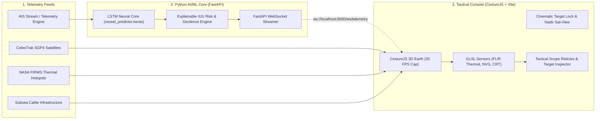

# ⚓ BLUE SENTINEL
### **Predictive Maritime Oversight // Indo-Pacific Node DL-04 // IUU Interdiction**


> <i>"The oceans are no longer a blind spot. Visibility is the ultimate weapon of sovereignty."</i>

---

## ⚡ OPERATIONAL BRIEFING
**BLUE SENTINEL** is an enterprise-grade C4ISR maritime domain awareness platform engineered to counter **Illegal, Unreported, and Unregulated (IUU)** fishing and dark vessel activity across the Indo-Pacific. 

The system operates on a **modern decoupled architecture**:
1. **Python AI/ML Telemetry Backend (FastAPI):** Ingests live AIS vectors, runs batch spatiotemporal inference through a trained **LSTM (Long Short-Term Memory)** neural core (`vessel_predictor.keras`), and calculates explainable multi-factor IUU risk indices.
2. **3D Tactical Web Console (CesiumJS + Vite):** A GPU-accelerated 3D geospatial environment running at a memory-governed 30 FPS with real-time GLSL post-processing sensors (FLIR Thermal, CRT Surveillance, NVG).

---

## 🏗️ SYSTEM ARCHITECTURE



---

## 🛰️ CAPABILITIES & FEATURES

* **🧠 LSTM Trajectory Anomaly Core:** Processes 10-step temporal vectors `[norm_lat, norm_lon, norm_sog, sin_cog, cos_cog]` to predict kinetic displacements and detect evasive loitering, zig-zagging, and MPA sanctuary incursions.
* **🛰️ Real SGP4 Orbital Propagation:** Propagates real satellite orbits (GSAT-7 Naval Recon, ISS, Cartosat-3) every 1 second via `satellite.js`.
* **📸 Satellite Direct View (Nadir Camera):** One-click camera lock placing the operator directly inside the satellite's downward-looking recon cone.
* **🔥 GLSL FLIR Thermal Shaders:** Hardware-accelerated Forward-Looking Infrared sensor simulation with White-Hot, Black-Hot, and Ironbow ("Predator" heat-map) color ramps.
* **📺 Tactical CRT Surveillance Mode:** Analog security monitor emulation with dynamic scanlines, barrel distortion, and timestamp watermark.
* **🌊 Kinetic Wake Trails & Geoid Snapping:** Glowing, risk-colored historical ribbons with EGM96 sea-surface clamping.
* **⚡ Render Governor (30 FPS Cap):** Limits frame rendering to 30 FPS with idle mode throttling, reducing GPU and RAM consumption by over 60%.
* **🎯 Target Lock & Focus De-emphasis:** Clicking any vessel interpolates the camera into tracking mode and dims surrounding non-suspicious traffic.
* **🌐 Undersea Infrastructure & Boundaries:** Integrated subsea telecommunications cables and Natural Earth marine territorial boundaries.

---

## 🚀 QUICK START PROTOCOL

### Prerequisites
* **Python 3.11+**
* **Node.js 20+**

### 1. Launch Everything via Unified Script (Windows PowerShell)
```powershell
./run_sentinel.ps1
```

### 2. Manual Startup

**Terminal 1 — Python ML Backend:**
```bash
pip install -r requirements.txt
$env:KERAS_BACKEND = "torch"
uvicorn backend.main:app --port 8000 --reload
```

**Terminal 2 — Vite 3D Tactical Console:**
```bash
cd frontend
npm install
npm run dev
```

Open your browser to: **`http://localhost:5173`**

---

## 📁 REPOSITORY STRUCTURE

```
BLUE SENTINEL/
├── backend/                  # FastAPI Python ML & Telemetry Service
│   ├── main.py               # REST API & WebSocket Streamer
│   ├── ml/
│   │   ├── predictor.py      # LSTM Model Loader & IUU Risk Engine
│   │   └── preprocessor.py   # 10-Step, 5-Feature Tensor Normalizer
│   ├── telemetry/
│   │   ├── ais_service.py    # Vessel Fleet Manager & Kinematic Simulation
│   │   └── weather.py        # Marine Weather Telemetry (Open-Meteo)
│   └── requirements.txt
├── frontend/                 # CesiumJS + Vite 3D WebGL Console
│   ├── index.html            # Tactical HUD & Layout
│   ├── vite.config.js        # Vite + Cesium Proxy Config
│   ├── public/data/          # Undersea Cables & Marine Boundaries GeoJSON
│   └── src/
│       ├── main.js           # Console Orchestrator
│       ├── core/
│       │   └── renderGovernor.js # 30 FPS Capped Render Governor
│       ├── shaders/
│       │   └── shaderPipeline.js # GLSL FLIR Thermal, CRT, NVG Shaders
│       ├── satellites/
│       │   └── satelliteManager.js # SGP4 Orbital Propagator & Nadir View
│       ├── vessels/
│       │   └── vesselManager.js  # WebSocket Telemetry, Trails, Target Lock
│       └── layers/               # Cables, Marine Boundaries, FIRMS Heatmaps
├── models/
│   └── vessel_predictor.keras # Trained LSTM Neural Core
├── archive/                  # Preserved legacy Streamlit scripts
├── run_sentinel.ps1          # One-Click Unified Launcher
└── README.md
```

---

## ⚖️ GOVERNANCE & LICENSE
Licensed under the **MIT License**. Maintained for maritime domain awareness and advanced geospatial intelligence research.
